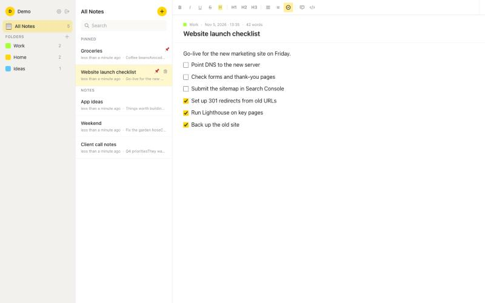
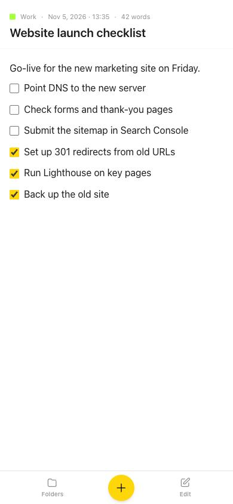

# Tickdown

**Notes that know when you're done.** A fast notes app with checklists: when you tick a task it drops to the bottom of its list on its own, so what is left to do always stays on top.

I built it for my own daily use, as a self-hosted alternative to Apple Notes that works the same on desktop and phone.





## Features

- **Self-sorting checklists.** Checked items move below the open ones automatically (a custom TipTap/ProseMirror extension), without strikethrough clutter.
- **Rich text editor** on TipTap: headings, bold, italic, underline, highlight, lists, task lists, code.
- **Folders with colors**, pinned notes, live search, word count and autosave.
- **Accounts:** sign-up and sign-in with JWT, bcrypt-hashed passwords, password change; every note is scoped to its owner.
- **Mobile-first layout:** bottom navigation, sliding panels, a scrollable toolbar and tap handling tuned for checkboxes on touch screens.
- **Production Docker setup:** MongoDB, API and web app on an isolated Docker network; only localhost ports are published, behind Nginx with SSL.

<br clear="right">

## Stack

| Part | Tech |
| --- | --- |
| Frontend | React 18, Vite, Tailwind CSS, TipTap (ProseMirror), Zustand, React Router, Axios |
| Backend | Node.js, Express, Mongoose, JSON Web Tokens, bcryptjs |
| Database | MongoDB 7 |
| Deployment | Docker Compose, Nginx reverse proxy, Let's Encrypt, Ubuntu VPS |

## API

| Method | Route | What it does |
| --- | --- | --- |
| POST | `/api/auth/register`, `/api/auth/login` | Create an account or sign in, returns a JWT |
| GET | `/api/auth/me` | Current user |
| PUT | `/api/auth/password` | Change password |
| GET, POST | `/api/notes` | List notes (by folder or search) or create one |
| GET, PUT, DELETE | `/api/notes/:id` | Read, update or delete a note |
| PATCH | `/api/notes/:id/pin` | Pin or unpin |
| GET, POST, PUT, DELETE | `/api/folders` | Manage folders |

All routes except register and login need `Authorization: Bearer <token>`.

## Run it

With Docker:

```bash
cp .env.example .env   # set JWT_SECRET (openssl rand -hex 32) and MONGO_PASSWORD
docker compose up -d --build
```

The web app is on `http://127.0.0.1:3010` and the API on `http://127.0.0.1:5010`. Put Nginx in front of them to serve it on a domain.

Without Docker (a local MongoDB on port 27017):

```bash
cd backend && npm install
MONGODB_URI=mongodb://127.0.0.1:27017/tickdown JWT_SECRET=dev-secret-at-least-32-characters-long npm run dev

cd frontend && npm install
API_TARGET=http://localhost:5000 npm run dev   # http://localhost:3000
```

Upgrading an install from before the rename (when it was called Checkmate): add `MONGO_USER=checkmate` and `MONGO_DB=checkmate` to `.env` so the existing database is used, then run `docker compose down` before `docker compose up -d --build`, because the container names changed.

Demo data: `DEMO_PASSWORD=... npm run seed:demo` in `backend/` creates (or resets) a demo account with sample folders and notes.

## Author

Built by [Roman Iglin](https://iglin.dev), full stack developer.
